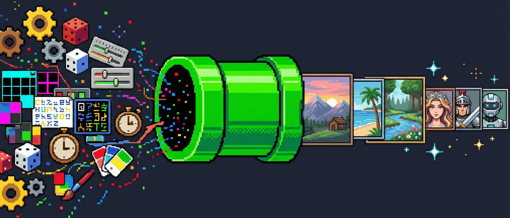
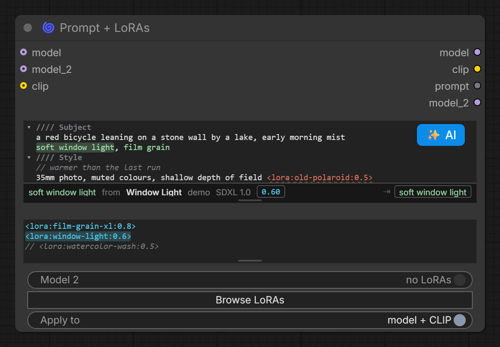
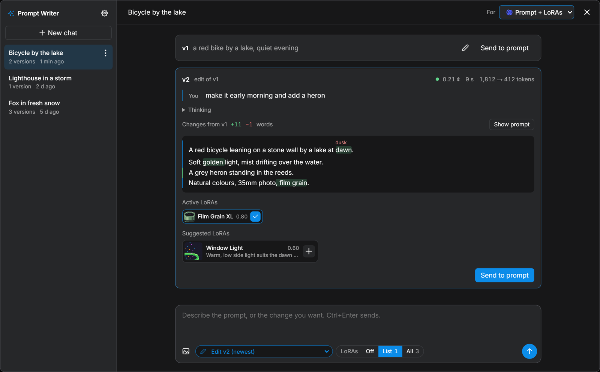
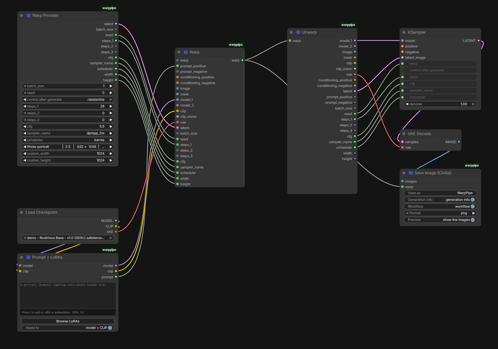
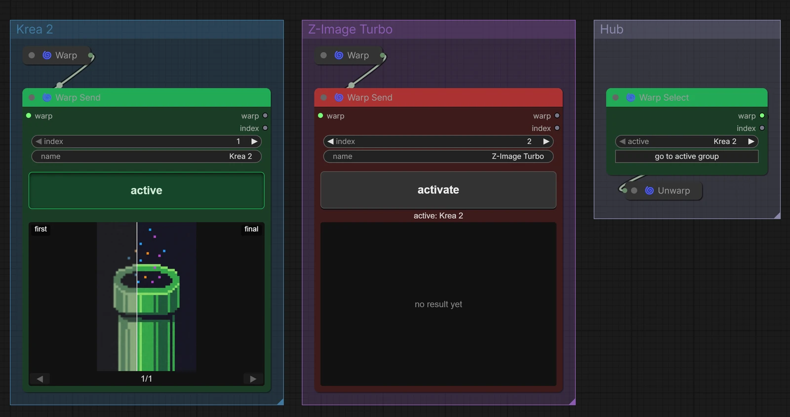
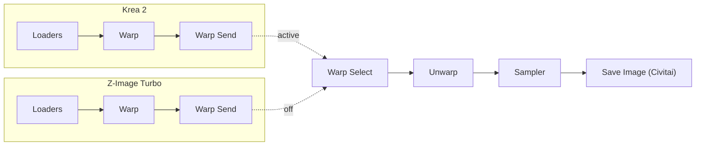
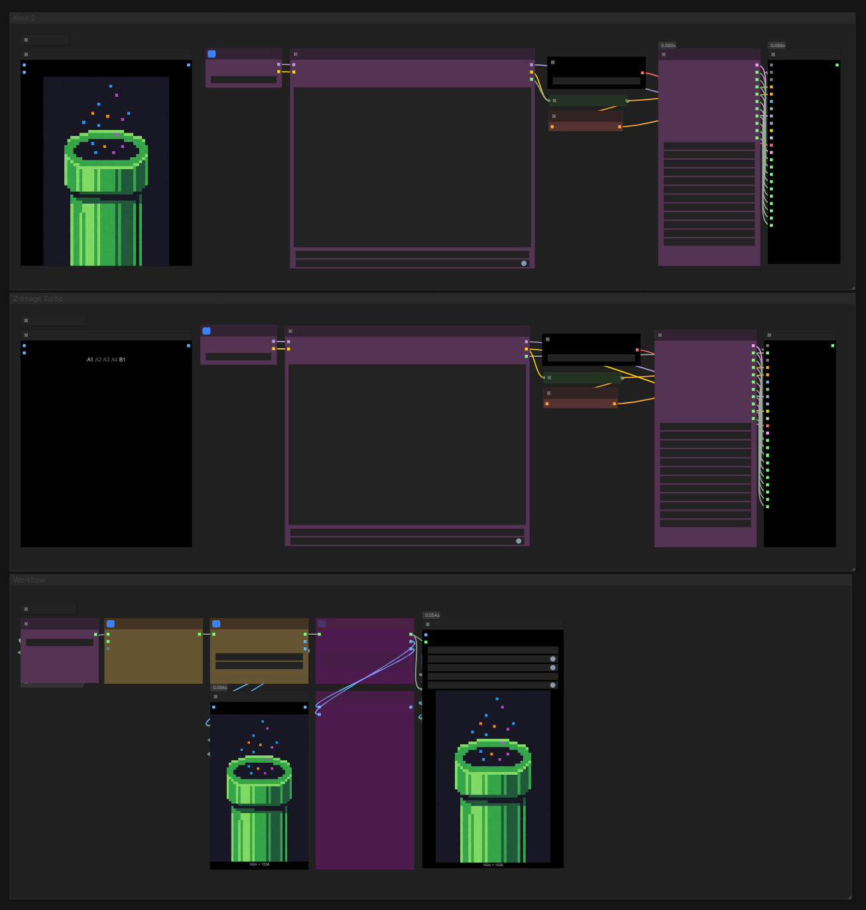
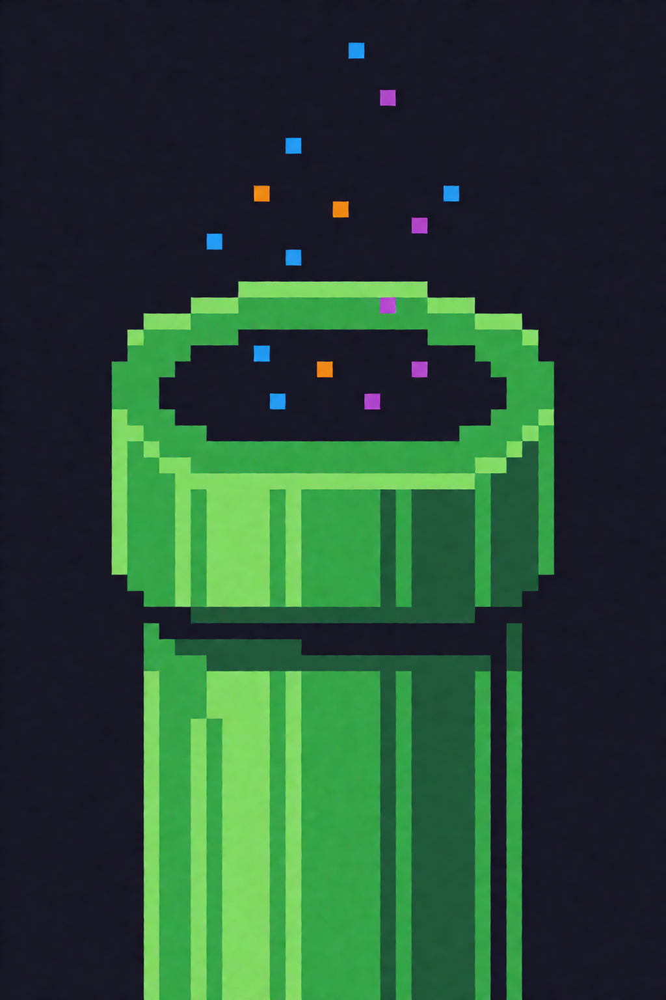

# WarpPipe

ComfyUI nodes for people who switch models a lot and like their LoRAs in the prompt.

- **Prompt + LoRAs**: LoRAs are tags in the text, and colours tell you what will load before you queue.
- **Prompt Writer**: an LLM chat behind every prompt box. Each answer is a version you can compare and send back.
- **Warp / Unwarp**: a whole generation in one wire.
- **Warp Send / Select**: switch between model groups without moving a wire.
- **Save Image (Civitai)**: metadata Civitai reads, so an upload credits the right model and LoRAs.

## Install

```bash
comfy node install warppipe
```

Or clone into `ComfyUI/custom_nodes` and restart. Python 3.9+, no extra dependencies.

## Prompt + LoRAs



The prompt goes on top, the LoRAs in the list below, one per line:

```text
//// Subject
a red bicycle leaning on a stone wall by a lake, early morning mist
soft window light, film grain
//// Style
// a note: never reaches the model
35mm photo, muted colours <lora:old-polaroid:0.5>
```

```text
<lora:film-grain-xl:0.8>
<lora:window-light:0.6>
// <lora:watercolor-wash:0.5>
```

| Colour | Means |
| --- | --- |
| cyan | the LoRA was found |
| red | no file by that name |
| orange | made for another base model |
| green | trigger word of a LoRA that is on (dim when it is off) |
| grey | a `//` note, or a LoRA switched off |

`////` starts a section you can fold. `/` completes from your LoRA library, `Tab`
on a tag adds its trigger words, `Ctrl+/` switches lines on and off. A second
list can feed `model_2` for two-pass setups.

## Prompt Writer



Click **✨ AI** on any prompt box and say what you want, with reference images if
you like. Every answer becomes a version. Edit it, write the next one from it, or
**Send to prompt**. **Show changes** marks what is new and puts the word it
replaced small above it.

- Works with NanoGPT out of the box, or any OpenAI-compatible server (LM Studio, Ollama, llama.cpp).
- The API key stays on the ComfyUI server (`user/warppipe_llm_keys.json` or `NANOGPT_API_KEY`). It never reaches the browser, a workflow or an image.
- Bring your own system prompts: a folder of `.txt` files, set under Settings → WarpPipe.
- It knows your LoRAs for the connected model and can suggest some. Nothing lands in your list until you press **+**.
- Chats are saved in the ComfyUI user folder and keep writing after you close the pop-up.

## One wire



A **Warp** takes models, conditioning, latents, prompts and sampler settings. One
link crosses the canvas, and an **Unwarp** gives it all back. Warps chain: one
further down carries everything the first did and adds to it.

## Switching model groups





Put a **Warp Send** at the end of each model group and one **Warp Select** in the
shared part. Press **activate** on a Send, or pick it in the Select, and only that
group runs. Green runs, red doesn't. If the routing is broken (nothing active, the
active Send muted, two Sends with one name) the queue says so instead of running.

The active Send shows the live preview while it samples
(`--preview-method auto`) and a before/after slider when it is done. Right-click
any image node and **Use as before image** to choose what goes on the left. The
same slider exists as its own node, **Warp Compare**.

## Save Image (Civitai)

Saves PNG or JPEG with the generation info Civitai reads. The `Hashes` field is
what makes an upload link the checkpoint and every LoRA:

```text
a red bicycle by a lake, early morning mist <lora:film-grain-xl:0.8>
Steps: 30, Sampler: dpmpp_2m, Schedule type: karras, CFG scale: 5.0, Seed: 44,
Size: 1024x1024, Model hash: 4c2b8e1f0a, Model: demo-sdxl,
Lora hashes: "film-grain-xl: 3b1f0c2a9d",
Hashes: {"model":"4c2b8e1f0a","lora:film-grain-xl":"3b1f0c2a9d"}, Version: ComfyUI-WarpPipe
```

It also shows what it saved next to the before image, in the same slider.

If you use [Civitai Updater](https://github.com/gregory-richard/comfyui-civitai-updater),
WarpPipe reads its `.civitai.info` files for trigger words, base models and titles.

## Example workflow



Krea 2 and Z-Image Turbo in one workflow. The image below was made with it and
has the workflow inside: drag it into ComfyUI to open it, or grab the
[JSON](examples/workflow_example.json).



## All nodes

| Node | |
| --- | --- |
| 🌀 Warp / Unwarp | Bundle a generation into one link and unpack it again |
| 🌀 Warp Provider | Latent and sampler settings, with size presets for current models |
| 🌀 Prompt + LoRAs | Prompt and LoRAs in one box |
| 🌀 Save Image (Civitai) | Save with metadata Civitai reads |
| 🌀 Warp Send / Warp Select | Pick which model group runs |
| 🌀 Warp Compare | Before/after slider |
| 🌀 Scheduler Adapter for FaceDetailer | KSampler schedulers for FaceDetailer |
| 🚫 Dead End | Takes anything, does nothing. Parks a branch |

Each node has its own help behind the `?` in ComfyUI. Everything else, every
input and the HTTP routes are in the **[wiki](WIKI.md)**.

## Credits

Screenshots use demo LoRAs and stand-in images, not anyone's real models.
Developed with AI assistance (Claude Opus 5). [MIT License](LICENSE).
